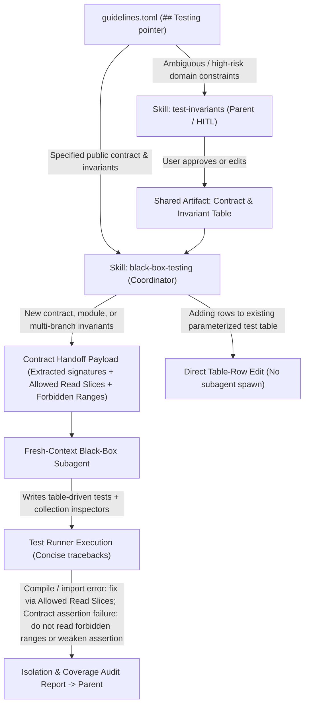

# Code-writing plugin and black-box contract testing skills

* **Author:** Mike Kobit
* **Status:** Draft
* **Date:** 2026-11-22

--------------------------------------------------------------------------------

## Overview

AI coding agents frequently write implementation-coupled unit tests that mirror private branches, mock internal collaborators, and assert tautologies instead of verifying observable domain behavior.
This design introduces a dedicated authored `code-writing` plugin under `src/chezmoi/dot_local/share/agent-plugins/marketplace/exact_plugins/exact_code-writing/` that packages two progressively disclosed testing skills (`test-invariants` and `black-box-testing`) alongside the renamed and migrated `java-writing` skill (formerly `modern-java-patterns`).
A two-line `## Testing` routing pointer in `src/chezmoi/.chezmoidata/ai/guidelines.toml` directs agents across Claude Code, Codex, Gemini/Antigravity, and Goose to scope business invariants interactively with `test-invariants` and author isolated contract tests with `black-box-testing`.

## The Problem

When an AI coding agent reads an implementation body in the same context window where it writes tests, attention contamination causes the model to transcribe internal control flow into test assertions.
The resulting test suites exhibit four recurring failure modes:

1. **Tautological assertions:** Tests duplicate internal helper calls, private calculations, or mock return values, passing even when business constraints are violated and breaking during safe internal refactors.
2. **Co-located source contamination:** In Python, TypeScript, Java, Kotlin, and Go, public signatures and private implementation bodies frequently share a single source file. Telling an agent to ignore implementation details without restricting its file-read context fails once the full file enters the prompt window.
3. **Unaligned domain invariants:** Agents guess edge cases from implementation branches rather than confirming domain constraints and excluded tautologies with the developer when specifications are ambiguous.
4. **Global prompt bloat and plugin boundary drift:** Inlining multi-language testing rules (data tables, collection inspectors, and subagent handoff schemas) into `src/chezmoi/.chezmoidata/ai/guidelines.toml` inflates every turn across all tools, violating progressive disclosure. Meanwhile, keeping code-authoring skills (`modern-java-patterns`) mixed into `mkobit-dotfiles` blurs the boundary between dotfiles/environment administration and code-authoring guidance.

## Goals

* Create the `code-writing` authored plugin in `src/chezmoi/dot_local/share/agent-plugins/marketplace/exact_plugins/exact_code-writing/` with plugin metadata in `src/chezmoi/.chezmoidata/ai/plugins/code-writing.toml` and host manifests for Claude Code, Codex, Cursor, and Antigravity.
* Rename and migrate `modern-java-patterns` from `exact_mkobit-dotfiles` to `exact_code-writing/exact_skills/exact_java-writing/` (`name: java-writing`, `display_name: "Java writing"`), and tombstone all retired `modern-java-patterns` paths across direct skill directories, Antigravity plugins, and Claude/Codex plugin caches.
* Author the `test-invariants` interactive human-in-the-loop (HITL) skill (`SKILL.md` under 40 lines, `exact_agents/openai.yaml`, and `exact_references/`) to propose and refine a shared **Contract & Invariant Table** (`| Case / input | Expected observable outcome | Collection / state inspector | Excluded tautology or internal detail |`) with the user before writing test code.
* Author the `black-box-testing` skill (`SKILL.md` under 40 lines, `exact_agents/openai.yaml`, and `exact_references/`) to enforce fresh-context subagent isolation via a structured **Contract Handoff Payload** (verbatim extracted signatures with `path#L<start>-L<end>` provenance, the Contract & Invariant Table, bounded `StartLine`/`EndLine` or `sed -n` allowed read slices, and forbidden implementation ranges), data-table parameterization, iterable/collection inspectors, and a returned **Isolation & Coverage Audit**.
* Add a two-line `## Testing` routing section in `src/chezmoi/.chezmoidata/ai/guidelines.toml` that routes ambiguous or high-risk constraint scoping to `test-invariants` and contract test writing to `black-box-testing`.
* Update `tests/integration/test_ai_skills.py` to verify deployment of `code-writing` (`java-writing`, `test-invariants`, `black-box-testing`) and removal of retired `modern-java-patterns` paths.

## Non-Goals

* Modifying upstream `superpowers:test-driven-development` or external skill catalogs in `src/chezmoi/.chezmoidata/ai/skills/`; instead, `test-invariants` and `black-box-testing` internalize the high-signal test-quality rules ("name the break", hand-derived literal expectations, boundary-only mocking, mutation checks, and full-suite verification) directly into `code-writing` so testing quality does not depend on `superpowers`.
* Implementing OS-level sandbox hooks or filesystem permission blocks to prevent subagent reads at runtime; epistemic isolation relies on the structured Contract Handoff Payload, bounded line-slice instructions, and the subagent's Isolation & Coverage Audit report.
* Moving external catalog skills (`dotnet-backend-patterns`, `go-concurrency-patterns`, `rust-async-patterns`) out of `mkobit-dotfiles`, which remains the sole `acquisition_destination = true` plugin (the `.chezmoidata/ai/plugin-bridge.toml` capability flag that routes external catalog skills into `mkobit-dotfiles`).

## Open Questions

* None. All architectural and naming decisions are resolved.

## Critical User Journeys (CUJs)

### CUJ 1: Interactive invariant alignment before test generation (`test-invariants` -> `black-box-testing`)

* **Given**: A developer asks an agent to test a domain module whose business constraints or boundary conditions are underspecified or high-risk.
* **When**: The agent follows the `## Testing` pointer in `guidelines.toml` and invokes `test-invariants`.
* **Then**: The parent agent extracts the public contract signatures, proposes a draft **Contract & Invariant Table** (including candidate business invariants, collection inspectors, and excluded internal tautologies), incorporates the developer's edits, and hands the approved table plus the **Contract Handoff Payload** to a fresh-context `black-box-testing` subagent.

### CUJ 2: Epistemically isolated contract test authoring on co-located source files (`black-box-testing`)

* **Given**: A public function or class and its private implementation body reside in the same source file, and the Contract & Invariant Table is already known.
* **When**: The parent agent invokes `black-box-testing` for a new contract or multi-branch invariant.
* **Then**: The parent agent extracts only the public signatures and types (`path#L<start>-L<end>`), lists allowed read slices (test fixtures, dedicated interface files, or bounded signature line ranges) and forbidden implementation line ranges in the **Contract Handoff Payload**, and dispatches a fresh-context subagent. The subagent writes table-driven tests using collection/iterable inspectors, executes the test suite, and returns an **Isolation & Coverage Audit** confirming no forbidden implementation ranges were read.

### CUJ 3: Clean migration from `modern-java-patterns` to `code-writing:java-writing`

* **Given**: A machine with a prior chezmoi deployment containing `mkobit-dotfiles` and `modern-java-patterns` in plugin directories, Antigravity plugins, or Claude/Codex plugin caches.
* **When**: The user runs `chezmoi apply` and executes `pytest tests/integration/test_ai_skills.py`.
* **Then**: `chezmoi apply` deploys `code-writing` with `java-writing`, `test-invariants`, and `black-box-testing`, removes `modern-java-patterns` from `mkobit-dotfiles`, Antigravity, direct skill paths, and plugin caches, and passes all integration tests.

## Technical Plan (Architecture)

### 1. System Architecture and Data Flow

The architecture splits responsibilities into three layers:

1. **Global Routing Layer (`src/chezmoi/.chezmoidata/ai/guidelines.toml`)**: Injects a two-line `## Testing` section into `~/.claude/CLAUDE.md`, `~/.codex/AGENTS.md`, `~/.gemini/GEMINI.md`, and Goose configuration. It routes ambiguous or high-risk business constraint discovery to `test-invariants` and contract test implementation to `black-box-testing`.
2. **Plugin Packaging & Bridge Layer (`code-writing`)**: Registers a new authored plugin folder under `src/chezmoi/dot_local/share/agent-plugins/marketplace/exact_plugins/exact_code-writing/` paired with `src/chezmoi/.chezmoidata/ai/plugins/code-writing.toml`. The existing `ai/authored-plugins`, `ai/plugin-bridge`, and `run_after_agent-plugin-bridge.sh.tmpl` templates automatically discover every `exact_<name>/` directory under `exact_plugins/`, render its Claude, Codex, Cursor, and Antigravity manifests, publish it in the local `dotfiles` marketplace, and reconcile native plugin registration across all hosts without changing `mkobit-dotfiles` as the external skill `acquisition_destination` (the capability flag that routes `.chezmoidata/ai/skills/` external skills into `mkobit-dotfiles`).
3. **Two-Stage Skill Execution & Epistemic Isolation Layer (`test-invariants` -> `black-box-testing`)**: Connects interactive human-in-the-loop (HITL) domain invariant alignment to an implementation-blind subagent via a shared **Contract & Invariant Table** and a structured **Contract Handoff Payload**, while absorbing high-signal test-design principles ("name the break", hand-derived literal expectations, boundary-only mocking, mutation checks, and full-suite verification) directly into `code-writing` so test quality is self-contained without relying on `superpowers:test-driven-development`.



### 2. Plugin Packaging and `java-writing` Migration

* **Plugin Identity (`src/chezmoi/.chezmoidata/ai/plugins/code-writing.toml`)**:
  Defines `[ai.plugins.code-writing]` with `description = "Code authoring and black-box testing guidance."` and `author = "mkobit"`.
* **Host Manifest Templates**:
  `exact_code-writing/` includes four single-line delegation templates matching `exact_mkobit-dotfiles/`:
  * `plugin.json.tmpl` -> `ai/agy/plugin-manifest` (`name = "code-writing"`)
  * `exact_dot_claude-plugin/plugin.json.tmpl` -> `ai/claude/plugin-manifest` (`name = "code-writing"`)
  * `exact_dot_codex-plugin/plugin.json.tmpl` -> `ai/codex/plugin-manifest` (`name = "code-writing"`)
  * `exact_dot_cursor-plugin/plugin.json.tmpl` -> `ai/cursor/plugin-manifest` (`name = "code-writing"`)
* **Skill Migration (`modern-java-patterns` -> `java-writing`)**:
  Moves `exact_mkobit-dotfiles/exact_skills/exact_modern-java-patterns/` to `exact_code-writing/exact_skills/exact_java-writing/`. Updates `SKILL.md` frontmatter `name: java-writing`, updates `description` and opening summary sentence to cover both writing new Java 17/21/25+ code and modernizing imperative Java patterns, sets heading `# Java writing`, updates `exact_agents/openai.yaml` to `display_name: "Java writing"`, and retains all six existing `exact_references/*.md` files unchanged.
* **Generic Authored-Plugin Tombstoning and Cache Cleanup**:
  * `src/chezmoi/.chezmoitemplates/ai/retired-skills`: Adds `"modern-java-patterns" "2026-11-22"` to `$retired` and generalizes the template by replacing its hardcoded `dig "mkobit-dotfiles"` lookup with a loop over every authored plugin in `includeTemplate "ai/authored-plugins" . | fromJson`. Because authored plugin skills are served from the marketplace plugin tree rather than legacy flat `~/.<tool>/skills/<name>` directories, this automatically emits flat `skills/<name>` tombstones in `dot_claude/.chezmoiremove.tmpl`, `dot_codex/.chezmoiremove.tmpl`, `dot_cursor/.chezmoiremove.tmpl`, and `antigravity-cli/skills/<name>` in `dot_gemini/.chezmoiremove.tmpl` for all active and `deselected` (disabled by environment/host configuration) skills across every authored plugin (`mkobit-dotfiles`, `code-writing`, and any future authored plugin) alongside `modern-java-patterns`.
  * `src/chezmoi/dot_claude/.chezmoiremove.tmpl` and `src/chezmoi/dot_codex/.chezmoiremove.tmpl`: Appends `plugins/cache/dotfiles/mkobit-dotfiles/*/skills/modern-java-patterns` so cached plugin snapshots under `~/.claude/` and `~/.codex/` prune the old skill location on `chezmoi apply`.
  * `exact_mkobit-dotfiles/exact_skills/`: Because `exact_skills/` uses chezmoi's `exact_` attribute, removing `exact_modern-java-patterns/` from `exact_mkobit-dotfiles/exact_skills/` automatically removes `.local/share/agent-plugins/marketplace/plugins/mkobit-dotfiles/skills/modern-java-patterns` and converges Antigravity's installed plugin tree via the plugin bridge.

### 3. Shared Data Schema: Contract & Invariant Table

Both `test-invariants` and `black-box-testing` communicate through a four-column Markdown table that separates observable domain behavior from private implementation mechanics:

| Case / input | Expected observable outcome | Collection / state inspector | Excluded tautology or internal detail |
|---|---|---|---|
| Domain scenario and boundary inputs | Hand-derived literal return value, state mutation, or raised domain error (naming the production break it catches) | Element-wise, order-sensitive, or subset assertion across returned collections/streams | Internal helper call, mock interaction, change detector, or private formula that must not be asserted |

### 4. Interactive Scoping Skill (`test-invariants`)

* **Layout**:
  * `exact_code-writing/exact_skills/exact_test-invariants/SKILL.md` (< 40 lines, one sentence per line, sentence-case headings)
  * `exact_code-writing/exact_skills/exact_test-invariants/exact_agents/openai.yaml` (`display_name: "Test invariants"`)
  * `exact_code-writing/exact_skills/exact_test-invariants/exact_references/invariant-checklist-and-examples.md`
* **Workflow**:
  1. **Extract Public Contract**: Reads only public signatures, data types, and domain documentation for the target unit (supporting both pre-implementation signature stubs and existing modules).
  2. **Propose Draft Contract & Invariant Table**: Synthesizes a concrete initial table where every row names the production break it catches (a real bug or broken contract, never an intentional refactor or constant-value change detector), covers happy-path domain rules, boundary transitions, and invalid inputs, specifies collection inspection semantics (exact order vs. any-order vs. single-element match), and lists explicitly excluded tautologies.
  3. **Single-Turn HITL Gate**: Presents the proposed table to the user for confirmation or inline adjustment rather than asking open-ended blank-slate questions.
  4. **Handoff**: Passes the approved table directly into `black-box-testing`.

### 5. Epistemically Isolated Authoring Skill (`black-box-testing`)

* **Layout**:
  * `exact_code-writing/exact_skills/exact_black-box-testing/SKILL.md` (< 40 lines, one sentence per line, sentence-case headings)
  * `exact_code-writing/exact_skills/exact_black-box-testing/exact_agents/openai.yaml` (`display_name: "Black-box testing"`)
  * `exact_code-writing/exact_skills/exact_black-box-testing/exact_references/handoff-and-isolation.md`
  * `exact_code-writing/exact_skills/exact_black-box-testing/exact_references/data-tables-and-inspectors.md`
* **Dispatch Threshold**:
  * **Spawn fresh-context subagent**: Required when testing a new contract, new module, or multi-branch business invariant.
  * **Inline edit permitted**: Allowed only when appending rows to an existing parameterized test table where the contract signature and assertion structure are already established.
* **Parent-to-Subagent Contract Handoff Payload**:
  When public signatures and private implementation bodies live in the same file (or when testing a pre-implementation signature stub), the parent coordinator extracts the contract first and sends the subagent four mandatory sections:
  1. **Extracted Public Signatures & Types**: Verbatim declaration lines and type definitions with provenance (`path#L<start>-L<end>`).
  2. **Contract & Invariant Table**: Either approved via `test-invariants` or derived from explicit contract documentation.
  3. **Allowed Read Slices**: Dedicated interface/type files, existing test files/fixtures, or bounded line-range read instructions (`read_file` with `StartLine`/`EndLine` or `sed -n '<start>,<end>p' <file>`) restricted strictly to public declarations.
  4. **Forbidden Implementation Ranges**: Explicit file paths and line ranges (`path#L<body_start>-L<body_end>`) containing private implementation bodies and internal helpers that the subagent is forbidden from reading, or `none (pre-implementation stub)` when writing contract-first tests before an implementation body exists.
* **Test Authoring Rules (`data-tables-and-inspectors.md`)**:
  * **Table-driven / parameterized execution**: Consolidates variations of an operation into a single data-table test per contract behavior (e.g., JUnit 5 `@ParameterizedTest` / Kotest `forAll(row(...))`, `pytest.mark.parametrize`, Go table slices, TypeScript `test.each`) using hand-derived literal expected values.
  * **Iterable and collection inspectors**: Uses structural collection assertions (e.g., AssertJ `extracting`/`satisfiesExactly`/`containsExactlyInAnyOrder`, Kotest `forAll`/`forAtLeastOne`, Python sequence/comprehension predicates) instead of manual index loops (`list.get(0)`) or fragile string-ified snapshots.
  * **Anti-tautology & real-collaborator guardrails**:
    * **Hand-derived expectations ("Name the break")**: Every row must fail on a real production bug (wrong branch, missing side effect, broken boundary validation) and never compute expected values by calling the code under test or its helpers.
    * **Exercise the real unit; mock only slow/external boundaries**: Never assert on a mock itself; mock only external or slow boundaries below the side effects under test, mirror complete real data structures in test doubles, switch to real collaborators when mock setup balloons, and keep test-only cleanup helpers in test utilities rather than production classes.
    * **Mental mutation check**: Verify that realistic production mutations (wrong constant/argument, wrong branch handler, missing state transition, empty/default return, missing nil/empty/zero validation) cause at least one table row to fail.
* **Subagent Test-Runner Execution & Epistemic Hygiene (`handoff-and-isolation.md`)**:
  * **Concise traceback flags**: The subagent runs test commands with concise traceback flags where supported (e.g., `pytest --tb=short` or `--tb=line`) so failing runs do not dump full implementation bodies into the subagent context window.
  * **Compile/Import Failure vs. Contract Assertion Failure Rule**: If a test fails to compile or import, the subagent fixes test-side syntax, imports, or types using only `Extracted Public Signatures & Types` and `Allowed Read Slices`. If a test compiles and executes but fails a contract assertion from the `Contract & Invariant Table` (or fails as expected against a pre-implementation stub), the subagent **must not** read `Forbidden Implementation Ranges` and **must not** weaken or alter expected values to match buggy implementation output; it records the failing contract row in the `Isolation & Coverage Audit` and returns control to the parent agent.
  * **Full-suite verification**: Before reporting completion, run the project's test suite command (or the target module's full test command) and report any failing test by name.
* **Subagent-to-Parent Isolation & Coverage Audit**:
  The subagent's completion message must include:
  * **Files and Line Ranges Read**: Complete list of files and exact line intervals read during the subagent turn, verifying zero overlap with Forbidden Implementation Ranges.
  * **Invariant-to-Table Mapping**: Which data-table test and row cover each row of the Contract & Invariant Table (and which mutation each row catches).
  * **Verification Output**: Exact test runner command executed, pass/fail status, and any contract assertion failures surfaced for parent remediation.

## Alternatives Considered

### Alternative A: Keep all testing skills and `modern-java-patterns` inside `mkobit-dotfiles`

* **Pros**: Avoids creating four new host manifest templates (`plugin.json.tmpl` and `.claude-plugin`, `.codex-plugin`, `.cursor-plugin` manifests) and a new `.chezmoidata/ai/plugins/code-writing.toml` metadata file; requires no plugin cache tombstones.
* **Cons**: Mixes language and test authoring guidance with dotfiles administration, sandbox operations (`sbx-sandboxes`, `openshell-sandboxes`), and issue tracking (`beads`). Prevents overlays or per-environment configurations from toggling code-writing skills independently of base dotfiles skills.
* **Reason for Rejection**: Rejected by author: code-authoring and testing preferences belong in a dedicated `code-writing` plugin in the local marketplace, with `java-writing` (formerly `modern-java-patterns`) migrated into it to keep domain boundaries clean.

### Alternative B: Keep the skill name `modern-java-patterns`

* **Pros**: Preserves existing skill slug references without needing tombstones for `modern-java-patterns` in `ai/retired-skills` or `.chezmoiremove.tmpl`.
* **Cons**: Restricts the skill's conceptual scope to JDK version migration patterns rather than general Java code-writing guidance and breaks naming consistency with the `code-writing` plugin.
* **Reason for Rejection**: Rejected by author: renamed to `java-writing` (`display_name: "Java writing"`) to match the `code-writing` naming convention and encompass broader Java authoring conventions.

### Alternative C: Inline all black-box testing rules, data-table examples, and iterable-inspector patterns directly into `src/chezmoi/.chezmoidata/ai/guidelines.toml`

* **Pros**: Eliminates the need for separate skill directories and reference markdown files; rules are immediately visible in the global prompt without skill activation.
* **Cons**: `guidelines.toml` is rendered into `~/.claude/CLAUDE.md`, `~/.codex/AGENTS.md`, `~/.gemini/GEMINI.md`, and Goose configuration on every conversation turn, regardless of whether the task involves testing. Inlining multi-language code examples and subagent handoff schemas violates the `write-agent-context` progressive-disclosure requirement, increases per-turn token usage, and dilutes instruction adherence on non-testing tasks.
* **Reason for Rejection**: Rejected by author: global guidelines are restricted to a two-line `## Testing` routing pointer, while detailed schemas and language-specific examples live in progressively disclosed `SKILL.md` and `exact_references/*.md` files.

### Alternative D: Allow the black-box subagent to read full co-located implementation source files without a structured Contract Handoff Payload

* **Pros**: Removes the parent agent's preliminary step of extracting public signatures and line ranges (`path#L<start>-L<end>`) before dispatching the subagent.
* **Cons**: In Python, TypeScript, Java, Kotlin, and Go, public interfaces and private implementation bodies frequently coexist in the same file. Once private implementation bodies enter the subagent's context window, attention contamination causes the model to mirror internal branches, mock private collaborators, and assert tautologies despite prompt instructions to ignore them.
* **Reason for Rejection**: Rejected by author: passing a structured **Contract Handoff Payload** (verbatim extracted signatures, the Contract & Invariant Table, bounded `StartLine`/`EndLine` or `sed -n` allowed read slices, and forbidden implementation ranges) plus an **Isolation & Coverage Audit** preserves epistemic isolation even for co-located source files.

--------------------------------------------------------------------------------

## Non-Functional Requirements

* **Performance & Token Economics**:
  * Global context overhead in `src/chezmoi/.chezmoidata/ai/guidelines.toml` is capped at one heading (`## Testing`) and two bullet lines so non-testing turns incur negligible token cost.
  * Each authored `SKILL.md` (`java-writing`, `test-invariants`, `black-box-testing`) is capped at under 40 lines with one sentence per line and sentence-case headings, deferring detailed schemas and multi-language examples to `exact_references/*.md`.
  * `black-box-testing` avoids subagent startup latency and prompt overhead when adding rows to an existing parameterized test table by permitting direct edits below the dispatch threshold.
* **Rollout, Idempotency & Rollback**:
  * Plain `chezmoi apply` must remain idempotent in both TTY and non-TTY environments.
  * Tombstones in `src/chezmoi/.chezmoitemplates/ai/retired-skills`, `dot_claude/.chezmoiremove.tmpl`, `dot_codex/.chezmoiremove.tmpl`, `dot_cursor/.chezmoiremove.tmpl`, and `dot_gemini/.chezmoiremove.tmpl` ensure machines upgrading from `mkobit-dotfiles:modern-java-patterns` automatically prune stale skill directories and plugin cache entries without manual cleanup commands.

--------------------------------------------------------------------------------

## Detailed implementation plan

### Target files to create, modify, or delete

#### 1. `src/chezmoi/.chezmoidata/ai/plugins/code-writing.toml` (Create)

* **Type / Scope**: Chezmoi TOML capability catalog metadata
* **Rationale**: Registers the `code-writing` plugin identity (`description` and `author`) so `ai/authored-plugins`, `ai/plugin-bridge`, and the four host manifest templates (`ai/agy/plugin-manifest`, `ai/claude/plugin-manifest`, `ai/codex/plugin-manifest`, `ai/cursor/plugin-manifest`) populate plugin manifests and marketplace listings.
* **Proposed Changes**: Define table `[ai.plugins.code-writing]` with `description = "Code authoring and black-box testing guidance."` and `author = "mkobit"`.

#### 2. `src/chezmoi/dot_local/share/agent-plugins/marketplace/exact_plugins/exact_code-writing/plugin.json.tmpl` (Create)

* **Type / Scope**: Antigravity plugin root manifest template
* **Rationale**: Renders `.local/share/agent-plugins/marketplace/plugins/code-writing/plugin.json` for Antigravity CLI installation via the plugin bridge.
* **Proposed Changes**: Delegate to `includeTemplate "ai/agy/plugin-manifest"` passing `(dict "name" "code-writing" "root" .)`.

#### 3. `src/chezmoi/dot_local/share/agent-plugins/marketplace/exact_plugins/exact_code-writing/exact_dot_claude-plugin/plugin.json.tmpl` (Create)

* **Type / Scope**: Claude Code plugin manifest template
* **Rationale**: Renders `.local/share/agent-plugins/marketplace/plugins/code-writing/.claude-plugin/plugin.json` so Claude Code discovers the `code-writing` plugin and its `./skills` directory.
* **Proposed Changes**: Delegate to `includeTemplate "ai/claude/plugin-manifest"` passing `(dict "name" "code-writing" "root" .)`.

#### 4. `src/chezmoi/dot_local/share/agent-plugins/marketplace/exact_plugins/exact_code-writing/exact_dot_codex-plugin/plugin.json.tmpl` (Create)

* **Type / Scope**: OpenAI Codex plugin manifest template
* **Rationale**: Renders `.local/share/agent-plugins/marketplace/plugins/code-writing/.codex-plugin/plugin.json` including `interface.capabilities` (`["black-box-testing", "java-writing", "test-invariants"]`).
* **Proposed Changes**: Delegate to `includeTemplate "ai/codex/plugin-manifest"` passing `(dict "name" "code-writing" "root" .)`.

#### 5. `src/chezmoi/dot_local/share/agent-plugins/marketplace/exact_plugins/exact_code-writing/exact_dot_cursor-plugin/plugin.json.tmpl` (Create)

* **Type / Scope**: Cursor plugin manifest template
* **Rationale**: Renders `.local/share/agent-plugins/marketplace/plugins/code-writing/.cursor-plugin/plugin.json` so Cursor discovers the `code-writing` plugin skills.
* **Proposed Changes**: Delegate to `includeTemplate "ai/cursor/plugin-manifest"` passing `(dict "name" "code-writing" "root" .)`.

#### 6. `src/chezmoi/dot_local/share/agent-plugins/marketplace/exact_plugins/exact_code-writing/exact_skills/exact_java-writing/SKILL.md` (Create / Move from `exact_mkobit-dotfiles/exact_skills/exact_modern-java-patterns/SKILL.md`)

* **Type / Scope**: Authored skill definition (Markdown with YAML frontmatter)
* **Rationale**: Migrates the existing Java authoring skill from `mkobit-dotfiles` into `code-writing` under its new slug `java-writing` and broadens its trigger description to cover both authoring new Java code and modernizing imperative Java.
* **Proposed Changes**: Update YAML frontmatter `name: java-writing`, update `description: Write and modernize Java 17/21/25+ code using records, sealed types, pattern matching, virtual threads, streams/Gatherers, sequenced collections, and Guava/AutoValue when already a dependency. Replaces imperative instanceof/cast chains, null-check ladders, hand-rolled POJOs and defensive copies, manual ExecutorService/Future, index-based collection access, and mutable-accumulator loops. Not for Spring or framework conventions; not for codebases below JDK 17.`, set top-level heading `# Java writing`, update the opening summary sentence to cover both writing new Java 17/21/25+ code and modernizing imperative symptoms, and preserve the JDK 17/21/25 quick reference table, reference links, and boundaries (< 40 lines, one sentence per line, sentence-case headings).

#### 7. `src/chezmoi/dot_local/share/agent-plugins/marketplace/exact_plugins/exact_code-writing/exact_skills/exact_java-writing/exact_agents/openai.yaml` (Create / Move from `exact_mkobit-dotfiles/exact_skills/exact_modern-java-patterns/exact_agents/openai.yaml`)

* **Type / Scope**: Codex skill UI metadata
* **Rationale**: Provides the human-readable display name for Codex skill listings.
* **Proposed Changes**: Set the 2-line Codex UI metadata matching `exact_mkobit-dotfiles/exact_skills/*/exact_agents/openai.yaml`:
  ```yaml
  interface:
    display_name: "Java writing"
  ```

#### 8. `src/chezmoi/dot_local/share/agent-plugins/marketplace/exact_plugins/exact_code-writing/exact_skills/exact_java-writing/exact_references/*.md` (Create / Move 6 files from `exact_mkobit-dotfiles/exact_skills/exact_modern-java-patterns/exact_references/`)

* **Type / Scope**: Progressive-disclosure skill references
* **Rationale**: Preserves the six JDK reference documents under the migrated `java-writing` skill directory.
* **Proposed Changes**: Move the following six files unchanged into `exact_code-writing/exact_skills/exact_java-writing/exact_references/`:
  * `immutability-and-value-types.md`
  * `jdk-milestones.md`
  * `pattern-matching-and-records.md`
  * `sequenced-collections.md`
  * `streams-and-gatherers.md`
  * `virtual-threads-and-structured-concurrency.md`

#### 9. `src/chezmoi/dot_local/share/agent-plugins/marketplace/exact_plugins/exact_mkobit-dotfiles/exact_skills/exact_modern-java-patterns/` (Delete directory and contents)

* **Type / Scope**: Retired skill directory removal
* **Rationale**: Removes `modern-java-patterns` from `mkobit-dotfiles` so chezmoi's `exact_` directory sync prunes `.local/share/agent-plugins/marketplace/plugins/mkobit-dotfiles/skills/modern-java-patterns` on apply.
* **Proposed Changes**: Delete `SKILL.md`, `exact_agents/openai.yaml`, and all six `exact_references/*.md` files from `exact_mkobit-dotfiles/exact_skills/exact_modern-java-patterns/`.

#### 10. `src/chezmoi/dot_local/share/agent-plugins/marketplace/exact_plugins/exact_code-writing/exact_skills/exact_test-invariants/SKILL.md` (Create)

* **Type / Scope**: Authored interactive HITL skill definition
* **Rationale**: Guides the agent through proposing and refining domain business invariants, failure breaks, and excluded tautologies with the user before writing tests.
* **Proposed Changes**: Author a < 40-line `SKILL.md` (frontmatter `name: test-invariants`, `description: Use when business constraints, edge cases, or observable outcomes are ambiguous, underspecified, high-risk, or requested for review before writing tests.`, top-level heading `# Test invariants`) using one sentence per line and sentence-case headings:
  * **When to use**: Before writing tests for underspecified, stateful, or high-risk domain behavior, or when the user asks to align on test cases first.
  * **Workflow**: (1) Inspect only public signatures, types, and domain documentation (supporting both pre-implementation signature stubs and existing modules); (2) Draft a proposed four-column **Contract & Invariant Table** (`| Case / input | Expected observable outcome | Collection / state inspector | Excluded tautology or internal detail |`) where every row names the real production break it catches and uses hand-derived literal outcomes rather than change detectors; (3) Present the table to the user in a single interactive confirmation turn for approval or edits; (4) Hand the approved table to `black-box-testing`.
  * **Reference pointer**: Link to `[invariant-checklist-and-examples.md](references/invariant-checklist-and-examples.md)`.

#### 11. `src/chezmoi/dot_local/share/agent-plugins/marketplace/exact_plugins/exact_code-writing/exact_skills/exact_test-invariants/exact_agents/openai.yaml` (Create)

* **Type / Scope**: Codex skill UI metadata
* **Rationale**: Sets the Codex display name for `test-invariants`.
* **Proposed Changes**: Set the 2-line Codex UI metadata:
  ```yaml
  interface:
    display_name: "Test invariants"
  ```

#### 12. `src/chezmoi/dot_local/share/agent-plugins/marketplace/exact_plugins/exact_code-writing/exact_skills/exact_test-invariants/exact_references/invariant-checklist-and-examples.md` (Create)

* **Type / Scope**: Progressive-disclosure reference for `test-invariants`
* **Rationale**: Keeps `SKILL.md` concise while providing concrete examples of high-signal business invariants versus implementation tautologies and change detectors.
* **Proposed Changes**: Document:
  * The **"Name the Break"** gate: before adding an invariant row, name the production bug (wrong branch, missing side effect, boundary violation, broken contract) that would make it fail, and reject change detectors (constant values, exact internal message wording, or framework wiring).
  * The invariant discovery checklist (domain conservation rules, boundary transitions, idempotency, error/rejection contracts, ordering vs. set-equivalence semantics).
  * Concrete examples of filled **Contract & Invariant Tables** showing how to populate hand-derived literal outcomes, `Collection / state inspector`, and `Excluded tautology or internal detail`.
  * Anti-patterns during HITL scoping (asking open-ended questions without proposing a draft table first, or leaking private helper names into invariant rows).

#### 13. `src/chezmoi/dot_local/share/agent-plugins/marketplace/exact_plugins/exact_code-writing/exact_skills/exact_black-box-testing/SKILL.md` (Create)

* **Type / Scope**: Authored black-box contract testing skill definition
* **Rationale**: Enforces epistemically isolated, contract-driven test authoring using data tables, iterable/collection inspectors, real collaborators, and mutation checks without implementation body contamination.
* **Proposed Changes**: Author a < 40-line `SKILL.md` (frontmatter `name: black-box-testing`, `description: Use when writing or expanding automated tests from public API contracts, types, and invariant tables without mirroring private implementation branches.`, top-level heading `# Black-box testing`) using one sentence per line and sentence-case headings:
  * **Core mandate**: Test observable business constraints through public contracts using hand-derived literal expectations, table-driven parameterization, and iterable/collection inspectors; exercise real units and mock only slow or external boundaries; never mirror internal control flow or assert on a mock itself.
  * **Dispatch threshold**: Spawn a fresh-context subagent for new contracts, new modules, or multi-branch invariants; edit inline only when adding rows to an existing parameterized test table.
  * **Subagent isolation & failure-handling protocol**: Parent extracts public signatures (`path#L<start>-L<end>`), passes the **Contract Handoff Payload** (signatures, Contract & Invariant Table, allowed read slices, and forbidden implementation ranges — or `none (pre-implementation stub)` for contract-first tests), and verifies the subagent's returned **Isolation & Coverage Audit**.
    The subagent runs tests with concise traceback flags, fixes compile/import issues using only allowed read slices, never reads forbidden ranges or weakens contract assertions when a contract assertion fails, applies a mental mutation check, and runs the project's test suite.
  * **Reference pointers**: Link to `[handoff-and-isolation.md](references/handoff-and-isolation.md)` and `[data-tables-and-inspectors.md](references/data-tables-and-inspectors.md)`.

#### 14. `src/chezmoi/dot_local/share/agent-plugins/marketplace/exact_plugins/exact_code-writing/exact_skills/exact_black-box-testing/exact_agents/openai.yaml` (Create)

* **Type / Scope**: Codex skill UI metadata
* **Rationale**: Sets the Codex display name for `black-box-testing`.
* **Proposed Changes**: Set the 2-line Codex UI metadata:
  ```yaml
  interface:
    display_name: "Black-box testing"
  ```

#### 15. `src/chezmoi/dot_local/share/agent-plugins/marketplace/exact_plugins/exact_code-writing/exact_skills/exact_black-box-testing/exact_references/handoff-and-isolation.md` (Create)

* **Type / Scope**: Progressive-disclosure reference for parent/subagent epistemic isolation and test-runner failure hygiene
* **Rationale**: Defines the exact parent-to-subagent **Contract Handoff Payload** template, co-located file slicing rules, pre-implementation stub handling, failure-handling rules, and subagent-to-parent **Isolation & Coverage Audit** schema.
* **Proposed Changes**: Document:
  * How the parent extracts public declarations from co-located source files and constructs bounded **Allowed Read Slices** (`read_file` with `StartLine`/`EndLine` or `sed -n '<start>,<end>p' <file>`) alongside **Forbidden Implementation Ranges** (`path#L<body_start>-L<body_end>`, or `none (pre-implementation stub)` when authoring contract-first tests before implementation code exists).
  * Copy-ready prompt structure for the **Contract Handoff Payload** (Extracted Public Signatures & Types, Contract & Invariant Table, Allowed Read Slices, Forbidden Implementation Ranges).
  * **Compile/Import Failure vs. Contract Assertion Failure Rule & Traceback Hygiene**: Instruct the subagent to run test runners with concise traceback flags (e.g., `pytest --tb=short` or `--tb=line`), fix compile/import/type errors strictly from `Extracted Public Signatures & Types` and `Allowed Read Slices`, and never read `Forbidden Implementation Ranges` or weaken expected values when a contract assertion fails.
  * **Full-suite verification**: Run the project's test command before completion and report every failing test by name.
  * Required **Isolation & Coverage Audit** output schema returned by the subagent (exact files and line intervals read, invariant-to-table row and mutation mapping, and test runner execution output).

#### 16. `src/chezmoi/dot_local/share/agent-plugins/marketplace/exact_plugins/exact_code-writing/exact_skills/exact_black-box-testing/exact_references/data-tables-and-inspectors.md` (Create)

* **Type / Scope**: Progressive-disclosure reference for data tables, collection inspectors, boundary-only mocking, and anti-tautology patterns
* **Rationale**: Provides multi-language idioms for table-driven tests, collection inspectors, real-collaborator discipline, and mutation checking without bloating `SKILL.md`.
* **Proposed Changes**: Document concise patterns and before/after anti-tautology comparisons across:
  * **Kotlin (Kotest)**: `forAll(row(...))` / `withData(...)` data tables and collection inspectors (`forAll`, `forExactly`, `forAtLeastOne`, `shouldContainExactlyInAnyOrder`).
  * **Java (JUnit 5 + AssertJ)**: `@ParameterizedTest` with `@MethodSource`/`@CsvSource` and AssertJ collection inspectors (`extracting`, `satisfiesExactly`, `satisfiesExactlyInAnyOrder`, `allSatisfy`).
  * **Python (pytest)**: `@pytest.mark.parametrize` with named case IDs and sequence/generator predicate assertions.
  * **Go & TypeScript**: Slice-of-struct table tests with `t.Run` and Vitest/Jest `test.each` with structural array matchers.
  * **Anti-tautology, mock-boundary, and mutation checklist**:
    * Derive expected values by hand as literals or hand-checked fixtures; never call the code under test or its helpers to compute expectations.
    * Exercise real collaborators by default; mock only slow or external boundaries below the side effects the test depends on, mirror complete real data structures in test doubles, never assert on a mock itself, and keep test-only cleanup helpers in test utilities rather than production classes.
    * Run a mental mutation check (wrong constant/argument, wrong branch handler, missing state change, empty/default return, missing zero/empty/nil/malformed input validation) to confirm at least one table row fails for each realistic production bug.

#### 17. `src/chezmoi/.chezmoidata/ai/guidelines.toml` (Modify)

* **Type / Scope**: Global AI agent instructions catalog
* **Rationale**: Routes all participating AI coding agents to `test-invariants` and `black-box-testing` using a two-line pointer that respects token budget constraints.
* **Proposed Changes**: Append a new `[[ai.guidelines.sections]]` entry with heading `## Testing` and the two routing bullets:
  * `- Scope ambiguous or high-risk business constraints with the test-invariants skill before writing tests.`
  * `- Write and expand tests with the black-box-testing skill from public contracts, data tables, and iterable inspectors without mirroring private implementation branches.`

#### 18. `src/chezmoi/.chezmoitemplates/ai/retired-skills` (Modify)

* **Type / Scope**: Chezmoi shared template for direct-skill root tombstones
* **Rationale**: Generically ensures every skill across all authored plugins discovered by `ai/authored-plugins` (`mkobit-dotfiles`, `code-writing`, and any future authored plugin) plus the retired `modern-java-patterns` name is tombstoned in flat host skill directories (`~/.claude/skills/`, `~/.codex/skills/`, `~/.cursor/skills/`, `~/.gemini/antigravity-cli/skills/`) because plugin skills are served from the marketplace plugin tree rather than flat host skill roots.
* **Proposed Changes**:
  * Add `"modern-java-patterns" "2026-11-22"` to the `$retired` dictionary.
  * Replace the hardcoded single-plugin lookup (`dig "mkobit-dotfiles" (dict) (includeTemplate "ai/authored-plugins" . | fromJson)`) with a generic `range $_, $bundle := includeTemplate "ai/authored-plugins" . | fromJson` loop, collecting both active `skills` and `deselected` (disabled by environment/host configuration) base names from every authored plugin.

#### 19. `src/chezmoi/dot_claude/.chezmoiremove.tmpl` (Modify)

* **Type / Scope**: Claude Code target removal template
* **Rationale**: Prunes stale cached copies of `modern-java-patterns` from Claude Code's versioned plugin cache for `mkobit-dotfiles`.
* **Proposed Changes**: Append `plugins/cache/dotfiles/mkobit-dotfiles/*/skills/modern-java-patterns`.

#### 20. `src/chezmoi/dot_codex/.chezmoiremove.tmpl` (Modify)

* **Type / Scope**: OpenAI Codex target removal template
* **Rationale**: Prunes stale cached copies of `modern-java-patterns` from Codex's versioned plugin cache for `mkobit-dotfiles`.
* **Proposed Changes**: Append `plugins/cache/dotfiles/mkobit-dotfiles/*/skills/modern-java-patterns`.

#### 21. `tests/integration/test_ai_skills.py` (Modify)

* **Type / Scope**: Pytest integration test suite
* **Rationale**: Generically validates all authored plugins (`mkobit-dotfiles`, `code-writing`, and future authored plugins) deployed by `chezmoi apply`, including host manifests, skill trees, Codex display names, marketplace entries, and tombstones for `modern-java-patterns`.
* **Proposed Changes**:
  * Introduce `PLUGINS_ROOT = Path(".local/share/agent-plugins/marketplace/plugins")` and a generic `AUTHORED_PLUGINS = ("mkobit-dotfiles", "code-writing")` (or expected skills map `AUTHORED_PLUGIN_SKILLS = {"mkobit-dotfiles": {...}, "code-writing": {"black-box-testing", "java-writing", "test-invariants"}}`) while preserving `BUNDLE_SOURCE` for `test_technical_writing_template_accepts_missing_ai_root`.
  * Parameterize `test_plugin_host_manifest_deployed_and_valid` and `test_antigravity_plugin_manifest_deployed_and_valid` across all authored plugins in `AUTHORED_PLUGINS`, asserting that each plugin's `manifest["name"] == plugin_name` and that `code-writing` exposes `black-box-testing`, `java-writing`, and `test-invariants`.
  * Parameterize `test_codex_base_skill_display_name_and_id` across `(plugin_name, skill_name, display_name)` tuples covering both `mkobit-dotfiles` (`("mkobit-dotfiles", "beads", "Beads")`) and `code-writing` (`("code-writing", "java-writing", "Java writing")`, `("code-writing", "test-invariants", "Test invariants")`, `("code-writing", "black-box-testing", "Black-box testing")`), verifying both `f'display_name: "{display_name}"'` in `agents/openai.yaml` and `f"name: {skill_name}"` in `SKILL.md`.
  * Update `test_marketplace_manifests_deployed_and_valid` to assert that every plugin in `AUTHORED_PLUGINS` (`mkobit-dotfiles` and `code-writing`) is registered at `f"./plugins/{plugin_name}"` in `.agents/plugins/marketplace.json`, `.claude-plugin/marketplace.json`, and `.cursor-plugin/marketplace.json`.
  * Update `test_host_skill_roots_tombstone_base_and_retired_skills` to assert that `skills/modern-java-patterns`, `skills/java-writing`, `skills/test-invariants`, and `skills/black-box-testing` appear in the rendered `.chezmoiremove.tmpl` output for `claude`, `codex`, and `cursor`, and that `plugins/cache/dotfiles/mkobit-dotfiles/*/skills/modern-java-patterns` is present in `claude` and `codex` removal lists.
  * Assert that neither `.local/share/agent-plugins/marketplace/plugins/mkobit-dotfiles/skills/modern-java-patterns` nor `.gemini/antigravity-cli/skills/modern-java-patterns` exists after apply.

#### 22. `AGENTS.md` (Modify)

* **Type / Scope**: Root repository architectural context
* **Rationale**: Updates the repository structure overview to reflect that authored AI plugins under `exact_plugins/` now include both `exact_mkobit-dotfiles/` (base dotfiles and environment skills) and `exact_code-writing/` (code authoring and black-box testing skills).
* **Proposed Changes**: Update line 19 in `## Repository structure` from `base skills live in exact_mkobit-dotfiles/exact_skills/.` to `authored skills live in exact_mkobit-dotfiles/exact_skills/ and exact_code-writing/exact_skills/.`.

### Verification plan

* **Template & Dry-Run Rendering**:
  * Run `chezmoi execute-template` on `src/chezmoi/.chezmoitemplates/ai/authored-plugins`, `src/chezmoi/.chezmoitemplates/ai/plugin-bridge`, `src/chezmoi/.chezmoitemplates/ai/retired-skills`, `src/chezmoi/dot_claude/.chezmoiremove.tmpl`, `src/chezmoi/dot_codex/.chezmoiremove.tmpl`, `src/chezmoi/dot_cursor/.chezmoiremove.tmpl`, and `src/chezmoi/dot_gemini/.chezmoiremove.tmpl` to confirm valid JSON/line output.
  * Run `chezmoi diff` to inspect all rendered target changes prior to applying.
* **Skill Line-Count & Style Audit**:
  * Verify `wc -l` is under 40 lines for `exact_java-writing/SKILL.md`, `exact_test-invariants/SKILL.md`, and `exact_black-box-testing/SKILL.md`.
  * Verify one sentence per line and sentence-case headings across all authored `.md` files in `exact_code-writing/`.
* **Static Analysis & Linting**:
  * Run `uv run ruff check tests/integration/test_ai_skills.py` and `uv run ruff format --check tests/integration/test_ai_skills.py` (or with `--no-project --with "ruff==${RUFF_VERSION}"` if local lock restrictions apply).
  * Run `uv run ty check --python .venv` (or with `--no-project --with "ty==${TY_VERSION}"`).
* **Integration Tests**:
  * Run `uv run pytest tests/integration/test_ai_skills.py` to verify end-to-end chezmoi deployment, plugin manifest generation, marketplace registration, and tombstoning.

--------------------------------------------------------------------------------

<!-- Provenance: Indicates initial structural drafting via EGM. -->

*Drafted with EGM*
