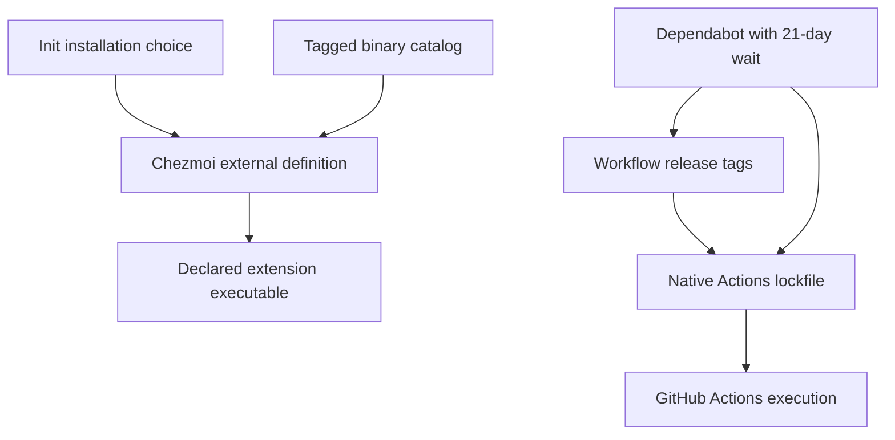

# GitHub extension management and workflow dependency locks

* **Author:** Mike Kobit
* **Status:** Implemented
* **Date:** 2026-11-13

## Implementation record

[PR #1078](https://github.com/mkobit/dotfiles/pull/1078) added extension management.
[PR #1079](https://github.com/mkobit/dotfiles/pull/1079) added workflow dependency locks.
Both PRs are merged.

Extension documentation is in [the managed extension README](../../src/chezmoi/dot_local/share/gh-managed/README.md), instead of the planned `docs/README.md`.
When the destination GitHub CLI executable is missing or not executable, apply downloads the enabled extension binaries but warns and skips registration.
A later apply retries registration without changing existing registrations or update state during the skipped attempt.

The remaining sections preserve the approved design and implementation plan.
They describe the decisions and requirements at approval time.
Use the implementation README files for current operating instructions.

## Overview

Deliver two separate pull requests for the dotfiles repository.
The first adds chezmoi management for `github/gh-stack` and `github/gh-actions-lock` with explicit release tags.
The second adds GitHub Actions dependency locks and sets the Actions Dependabot release waiting period to 21 days.
Neither PR requires the other to merge first.

## The problem

The repository does not define installation of these two GitHub CLI extensions.
Personal environments need repeatable installation, but work environments must be able to disable management through chezmoi init configuration.
Disabled management must leave existing installations unchanged.

Workflows currently use commit SHAs for external actions.
Readable version tags need a separate record of the exact commits that GitHub Actions will run.
Native workflow dependency locks provide that record.
The Actions Dependabot configuration currently has a 14-day release waiting period; the requested period is 21 days.

## Goals

- PR 1 makes each enabled extension match the declared release tag, including upgrades and downgrades.
- Missing or disabled init choices cause no installation, update, or removal of either extension.
- PR 1 uses the repository's catalog and init configuration pattern and supports work overlays.
- Initial extension releases meet the requested 21-day release waiting period.
- Separate tool update work handles later extension version changes.
- PR 2 uses readable action version tags where native locks record exact execution commits.
- PR 2 defines how to cover the remote dependency inside the local `setup-mise` action.
- Dependabot maintains supported action versions and matching lock entries with a 21-day waiting period for version updates.
- Each PR can be reviewed, tested, and merged separately.

## Non-goals

- Add an extension version update service or Dependabot support for arbitrary chezmoi catalog data.
- Remove extensions or change installations when management is disabled.
- Change the uv Dependabot waiting period.
- Require a stacked PR workflow or install extension agent skills.
- Delay security updates through the version-update waiting period.
- Claim that Dependabot controls manual lockfile changes.
- Replace separate pins for dependencies outside native lock coverage.

## Open questions

None.

## Critical user journeys

### Apply an enabled extension

- **Given:** Init configuration enables the extension, and the catalog declares its release and platform checksum.
- **When:** The user runs `chezmoi apply`.
- **Then:** Chezmoi downloads the declared asset, verifies its checksum, and registers the local executable directory.
- **Then:** An older or newer existing version is replaced by the declared version.
- **Then:** A second apply leaves the executable and its registration unchanged.

### Apply with extension management disabled

- **Given:** The init choice is missing or disabled, with or without an existing extension installation.
- **When:** The user runs `chezmoi apply`.
- **Then:** Extension management performs no download, registration, update, or removal.
- **Then:** Any existing installation remains unchanged.

### Review an Actions version update

- **Given:** A workflow uses a supported release tag with a committed native lock entry.
- **When:** Dependabot proposes a version update after the 21-day waiting period.
- **Then:** The PR contains the reference change and its matching lock update.
- **Then:** Repository checks verify the lock before merge.
- **Then:** The review includes changes to exact execution commits.

### Change the local setup action

- **Given:** Workflows use the supported migrated reference to `setup-mise`.
- **When:** A contributor changes an action dependency and regenerates the lock.
- **Then:** The lock includes the nested remote dependency, and the setup action retains its inputs, outputs, and version selection.

## Technical plan

### Shared controls

Store release tags, platform assets, checksums, and release age settings in binary catalog entries.
Keep installation choices in the init template.
Missing choices default to `none` through `dig`.
Disabled choices emit no external download entries and run no registration commands.
Do not use an `exact_` directory or removal entries for extension storage.
All managed paths use `{{ .chezmoi.destDir }}`.

Enabled management makes the installed executable match the declared release tag.
A lower declared tag causes a downgrade.
Changing the tag changes the external download definition.
Repeated apply with the same tag must not change the installation.

### PR 1: Extension installation

The current repository has a [binary update workflow](../../.github/workflows/upgrade-bin-tools.yml).
It scans binary catalogs and opens update PRs.
Its [cooldown code](../../src/python/bin_updater/bin_updater/cooldown.py) supports a per-catalog `minimum_release_age` setting.
Set each extension catalog to 21 days in the supported format.
Use this existing tool update work; add no extension-specific updater.

The repository requires binary downloads through chezmoi externals.
The author selected local registration.
Chezmoi externals download and verify the declared release binary into a managed directory named `gh-NAME`.
That directory contains the executable `gh-NAME`.
After deployment, an enabled-only script changes its working directory to the managed directory and runs `gh extension install .`.
Registration uses the existing local binary and does not download it again.
See the [local install dispatch](https://github.com/cli/cli/blob/v2.97.0/pkg/cmd/extension/command.go).
Future changes to the declared tag replace the managed binary; the local registration continues to reference its directory.
The script leaves an existing registration unchanged when it already points to the managed directory.
If an enabled extension has a different registration, replace that registration only after the managed executable is available.
Disabled management performs neither download nor registration changes.

Both local registration and direct manifest installation can use identical pinned assets and checksum verification.
Local registration uses the supported CLI interface instead of writing the internal binary manifest format.

GitHub CLI uses `XDG_DATA_HOME/gh` for extension storage when `XDG_DATA_HOME` is set.
Otherwise its Linux and macOS storage is under `.local/share/gh`.
Tests must direct registration into the test destination.
Do not assume `GH_CONFIG_DIR` changes extension storage.
Registration commands set `XDG_DATA_HOME` to `{{ .chezmoi.destDir }}/.local/share` and `XDG_STATE_HOME` to `{{ .chezmoi.destDir }}/.local/state`.
GitHub CLI local install and removal also delete extension update state under `XDG_STATE_HOME/gh/extensions/gh-NAME`.
Both overrides are required to keep registration writes within the destination.
See the [versioned GitHub CLI path implementation](https://github.com/cli/go-gh/blob/v2.13.0/pkg/config/config.go).
Before modifying an enabled installation, reject a non-empty inherited `XDG_DATA_HOME` that differs from this location.
Report the mismatch so apply cannot register an extension where normal `gh` invocation will not find it.
Disabled choices bypass this check.
Custom extension storage outside the destination is outside this design.

See the [local registration interface](https://cli.github.com/manual/gh_extension_install) and [GitHub CLI extension manager source](https://github.com/cli/cli/blob/v2.97.0/pkg/cmd/extension/manager.go).

### PR 2: Workflow locks

Change only the Actions Dependabot version-update waiting period from 14 to 21 days.
Retain its existing update schedule and groups.
Replace supported action SHA references with full release tags and commit the corresponding native lockfile.
Review any change from the current execution commits.
Keep separate SHA pins for references that native locks do not cover.
Preserve the existing untagged `jdx/mise-action` commit and include it in the lock.
No full release tag identifies that commit, and an eligible older release would remove its existing cache-hang fix.

The local composite action `.github/actions/setup-mise/action.yml` calls `jdx/mise-action`.
Its callers include `ci.yml` and `upgrade-bin-tools.yml`.
Use the lock tool's supported local-action migration with `--migrate-local-actions`.
The tool changes same-repository local action references from `./` to its supported `$/` form.
Review those reference changes together with the generated lockfile.
Preserve the composite action's inputs, outputs, mise version selection, and caller behavior.
Include the nested remote `jdx/mise-action` dependency in lock coverage.
Do not use `--ignore-local-actions` to bypass this dependency.
Check the selected tool release and runner support before applying the migration.
Define CI lock verification and its tool installation separately from personal chezmoi configuration.

### PR independence

PR 1 provides personal extension installation.
PR 2 supplies workflow references, committed locks, and repository verification.
Neither requires the other PR to merge first.

## Alternatives considered

### Write GitHub CLI extension manifests directly

This would let chezmoi place binaries and registration metadata without an after script.
It depends on GitHub CLI's internal manifest format.
Rejected by author: use local registration through the supported CLI interface.
For GitHub CLI 2.97.0, change into the managed directory and run `gh extension install .`; an absolute directory argument is not supported.
Both approaches can use the same pinned release assets and catalog checksums.

### Install an extension only when absent

This would preserve an existing manually selected version.
It would also leave enabled installations different from the declared version after catalog changes.
Rejected by author: enabled management must apply the declared version, including downgrades.

### Remove extensions when management is disabled

This would make disabled mean absent.
Rejected by author: disabled means ignore the installation, with no install, update, or removal.

### Use raw SHAs in authored extension version configuration

Commit references identify source revisions but do not provide the requested release-tag configuration.
Rejected by author: declare extension release tags and leave version updates to the existing tool update work.
Native Actions lockfiles still record exact execution commits.

### Make the Actions lock PR depend on the extension installation PR

This would put personal tool installation before repository lock adoption.
No merge dependency is required because GitHub Actions reads the committed lockfile independently of personal chezmoi configuration.
Keep the two PRs independent.

### Add another extension updater or lock format

A separate updater would duplicate the repository's tool update work.
A custom Actions lock format would duplicate native workflow locks and their Dependabot integration.
Use the existing mechanisms within their supported scope.
Dependabot updates for arbitrary chezmoi version data remain outside these PRs.

### Ignore local actions during lock generation

Ignore mode avoids migration of same-repository action references.
It can leave the remote action inside `setup-mise` outside lock coverage.
The author selected supported local-action migration to include that dependency.

## Detailed implementation plan

Implement each PR in its own feature branch and isolated worktree.
Check the current repository source before changes.
Do not edit deployed configuration directly.

### PR 1: Required files

| File | Change and reason |
| --- | --- |
| `src/chezmoi/.chezmoidata/bin/gh-stack.toml` | Create the GitHub release catalog for `github/gh-stack`, with a declared release version, asset patterns, platform mappings, checksums, and `minimum_release_age = "21d"`. |
| `src/chezmoi/.chezmoidata/bin/gh-actions-lock.toml` | Create the equivalent catalog for `github/gh-actions-lock`. |
| `src/chezmoi/.chezmoi.toml.tmpl` | Add extension installation choices under `data.gh.extensions`, separate from the generic binary installation choices. Enable supported personal installations; overlays can omit or disable each choice. |
| `src/chezmoi/dot_local/share/gh-managed/.chezmoiexternals/extensions.toml.tmpl` | Create the guarded external definitions that download each enabled executable into its own managed extension directory. |
| `src/chezmoi/.chezmoiscripts/run_after_09_register-gh-extensions.sh.tmpl` | Create an after script that checks and repairs enabled registrations on every apply. |
| `tests/integration/test_gh_extensions.py` | Create integration coverage for rendered external definitions, declared versions, registration, disabled behavior, and repeated apply. |
| `README.md` | In the final documentation phase, add a short extension overview and link to `docs/README.md`. |
| `docs/README.md` | In the final documentation phase, explain extension catalog metadata, init controls, local registration, and version updates. |

Use catalog keys `bin.gh-stack` and `bin.gh-actions-lock`.
Under each catalog's `github_releases` table, set `bin_name` to `gh-stack/gh-stack` or `gh-actions-lock/gh-actions-lock`.
The dedicated external template can then reuse the shared GitHub release renderer without changing its target handling.
The managed directories are `{{ .chezmoi.destDir }}/.local/share/gh-managed/gh-stack` and `{{ .chezmoi.destDir }}/.local/share/gh-managed/gh-actions-lock`.

Under the init template's `data.gh.extensions` table, give each extension its own `installation_method` choice.
Use `github_releases` for enabled management and `none` for disabled management.
Read each choice with `dig` and default to `none`.
Do not add these extension choices to `data.local.bin`.
The generic binary dispatcher must therefore skip both catalogs and must not create duplicate `.local/bin` downloads.

The existing binary updater scans the catalogs and supports their 21-day setting.
Do not change its workflow, service, or global default waiting period in PR 1.
A path in `bin_name` must not change upstream asset selection.
Verify this with the updater's existing catalog and service checks.

### PR 1: Release selection and registration

Select the newest stable release that has been published for at least 21 days and supplies the required Linux and macOS assets for amd64 and arm64.
For the lock extension, also require support for the selected local-action migration.
Use the repository's current checksum catalog pattern.
Do not use an unqualified latest release or silently omit a required platform.
If no release meets these conditions, report the unmet prerequisite before implementation.

Render no download or registration work for a disabled extension.
For enabled extensions, first confirm that the managed executable exists and is executable.
A warning from local installation is not sufficient evidence that the executable exists.
Use the destination's managed `gh` executable and isolate its data directory as specified in the technical plan.

Compare the existing local registration link target with the expected managed directory.
Leave a matching registration unchanged.
If another registration exists, remove only its computed registration path after checking the replacement executable.
Unlink registration symlinks without following their targets; remove a real registration directory only at that exact path.
Do not call `gh extension remove`, whose authentication gate prevents offline replacement.
The subsequent local installation clears the extension update state.
Change the script's working directory to the managed extension directory and run `gh extension install .`.
Do not use `--pin` or `--force` for local registration.
Chezmoi controls the version through the executable asset and checksum.
If registration fails, stop apply and report the extension, operation, and command error without credentials.
A later apply must retry registration.

Use `run_after` so apply can repair registration changes even when the script content has not changed.
A matching registration makes repeat execution a no-op.
Do not remove the managed directories or registrations when configuration later becomes disabled.

### PR 2: Required files

| File | Change and reason |
| --- | --- |
| `.github/dependabot.yml` | Change the Actions `cooldown.default-days` value to 21; preserve the uv entry, schedules, and groups. |
| `.github/workflows/ci.yml` | Replace lock-supported external SHA references with full release tags and migrate local setup action references through the lock tool. |
| `.github/workflows/upgrade-bin-tools.yml` | Apply the same reference migration so the existing tool update workflow is included in lock coverage. |
| `.github/workflows/check-comments.yml` | Convert supported action references to full release tags and include the workflow in the lock; retain its comment rule unless generated output proves a conflict. |
| `.github/workflows/verify-lockfile.yml` | Create a read-only lock verification workflow with its own pinned lock extension installation, independent of personal chezmoi setup. |
| `.github/workflows/actions.lock` | Create the generated native dependency lock for all onboarded workflows and supported nested dependencies. |
| `README.md` | In the final documentation phase, link to `.github/workflows/README.md`. |
| `.github/workflows/README.md` | In the final documentation phase, explain lock generation, verification, version waiting periods, and local-action migration near the workflow files. |

First identify full release tags that resolve to the currently pinned action commits.
Keep the existing execution commits where such tags exist.
If a tag requires a different commit, identify that change explicitly in the PR and apply the 21-day release selection rule.
Do not substitute a branch or partial major tag for a full release tag.
Keep unsupported references separately pinned.

Create the verification workflow before the final lock generation so its own action references are covered.
Run it for pull requests and pushes to the default branch with `contents: read`.
Use the standard workflow token through `GH_TOKEN` without adding a personal token.
Install `github/gh-actions-lock` with an explicit qualified release tag in CI.
This is a CI tool bootstrap, not a personal dotfile download script.
Its tag must not require PR 1's catalog to exist.
Use `gh actions-lock --verify` for the read-only CI check.
Do not treat `--verify-local` as equivalent verification.

Run `gh actions-lock --migrate-local-actions` from the repository root after editing all references.
Review the generated `$/` references and confirm that the action runs at the workflow commit rather than arbitrary checked-out workspace content.
Verify the nested `jdx/mise-action` entry for each workflow that uses `setup-mise`.
Preserve the composite action's current mise catalog lookup.

Check generated workflow output against the [workflow comment check](../../.github/workflows/check-comments.yml).
The check rejects one or more spaces before `#`, followed by optional spaces or tabs, then `v` and one or more digits, such as ` # v1.2.3`.
It checks all lines in `.github/workflows/*.yml` and `.github/workflows/*.yaml`, including lines without action references.
Keep the rule if the generated output complies.
If the selected tool adds rejected comments, remove redundant comments from the generated workflow changes rather than disable the rule.
Run lock verification again after any such edit.

### Verification plan

For PR 1, create isolated fixtures inside `tests/integration/test_gh_extensions.py`.
Do not use the shared initialized-deployment fixture for mutating apply cases.
Follow the [copied-source and local-server pattern](../../tests/integration/test_claude_code.py) and [integration test instructions](../../tests/integration/AGENTS.md).
Each case owns temporary source, config, destination, cache, and persistent state paths.
Copy only the external template, registration script, shared release renderer, and required supporting templates into that source.
Supply catalog data and init choices through the test's configuration.
Serve fake extension payloads through a local HTTP server on a system-assigned port and compute their SHA-256 checksums from the payload bytes.
Do not fetch release assets during these tests.

Use the real installed `gh` executable supplied by the test environment.
Resolve it before changing the environment, record its version, and copy it into the temporary destination's `.local/bin`.
Treat an unavailable or unsupported GitHub CLI executable as an unmet test prerequisite; do not replace registration behavior with a fake CLI.
Use fixture payloads as the extensions so invocation can confirm which declared version is active.
Local registration requires no authentication in the inspected GitHub CLI path.

Pass explicit `--config`, `--source`, `--destination`, `--cache`, and `--persistent-state` paths to the real chezmoi commands.
Use chezmoi's own data, render, and apply operations for assertions.
Set `XDG_DATA_HOME`, `XDG_STATE_HOME`, `XDG_CACHE_HOME`, and `GH_CONFIG_DIR` to case-owned paths for every real `gh` command and for the apply subprocess.
GitHub CLI appends `gh` to the three XDG directories; `GH_CONFIG_DIR` names the configuration directory directly.
Set the data and state locations to the temporary destination's `.local/share` and `.local/state` so they match the registration script.
Verify that each resolved data, state, cache, and configuration location is within the case directory before running a command.
Use separate test-owned sentinel directories to check that inherited host-like extension and update state remain unchanged.
Clear inherited authentication tokens and host selectors from the test subprocess environment.
Never use real host configuration, authentication, cache, extension registry, or update state for these tests.

Cover absent installation, a matching local registration, replacement of another installation, upgrade, downgrade, registration repair, and repeated apply.
Cover missing and explicitly disabled choices with both absent and existing installations.
Assert that disabled management makes no extension download or registration call and preserves existing content.
Check both extension choices independently.
Check wrong checksums, missing executables, registration failures, and conflicting inherited data paths.
Render all four supported platform combinations.
Check that the generic binary dispatcher emits no duplicate extension targets.

Run the repository's required Python lint, format, type, unit, and integration checks that apply to the new test file.
Use the approved local tool versions if the locked versions cannot run, and report the versions used.
Before deploying PR 1, run `chezmoi diff` and inspect only its intended targets, then run `chezmoi apply` and repeat apply to check idempotence.

For PR 2, run `gh actions-lock --verify` after generation and after any workflow edit.
Confirm that every supported workflow and the nested setup dependency are covered.
Verify that a second generation without dependency changes produces no diff.
Run the existing workflow comment check and repository checks.
Before merge, record a successful run URL, the workflow revision, and the lockfile content at that revision.
Read the action preparation log and compare its resolved commits for direct and nested remote actions with the lock entries.
The runner reports the resolved commit in `Download action repository ... (SHA:...)` messages or immutable package metadata that contains `Source commit SHA`.
See the [runner action preparation source](https://github.com/actions/runner/blob/main/src/Runner.Worker/ActionManager.cs).
Keep this evidence with the PR validation results.

Have the verification workflow record `github.workflow_sha` in its validation output.
For migrated same-repository actions, verify the `$/` references at that workflow revision.
The [runner resolves these references](https://github.com/actions/runner/blob/main/src/Runner.Worker/ActionManager.cs#L178) with the workflow repository and workflow SHA.
Compare any preparation log entry for the same-repository action with the recorded workflow SHA.
If the runner does not emit that entry, record the workflow SHA and the source-defined resolution behavior as the evidence limit.
Do not claim an independent runtime proof for that action or infer its revision solely from the workspace checkout.

A matching preparation log confirms the executed revisions.
When the current tags resolve to those same commits, the log does not by itself prove that the lock caused resolution.
The [native lockfile contract](https://docs.github.com/en/actions/concepts/security/workflow-dependency-lockfiles#how-does-the-lockfile-work) supplies that enforcement guarantee.
Do not move upstream tags or run untrusted action code to test causality.

Stop PR 2 adoption if the repository rejects the lock or `$/` syntax, a resolved remote commit differs from its lock, or the required execution evidence cannot be obtained.
Retain the existing SHA references and report the unmet prerequisite instead of merging the tag migration.
Do not remove existing SHA protection from unsupported references or claim lock enforcement from a successful file generation alone.

### Final phase: Write README files

Complete this phase at the end of each implementation PR, after the behavior and checks are settled.
Write only the important configuration, usage, and maintenance information that matches the implemented result.
Do not copy the full design into the README files.

For PR 1, create `docs/README.md` with the catalog and init control split, the two extension controls, disabled behavior, local registration, declared-version reconciliation, checksums, and the 21-day version update setting.
Include the supported data directory and explain that chezmoi updates the binaries registered locally with GitHub CLI.
Keep Markdown files outside `.chezmoidata`, where chezmoi parses files as data.
Check that adding `docs/README.md` does not change chezmoi's rendered data or deployed targets.

For PR 2, create `.github/workflows/README.md` with the commands to generate and verify locks, the `$/` local-action behavior, the Dependabot waiting period and its limits, and the references that still need separate pins.
Explain that workflow and lock changes must be reviewed together.

Update the root `README.md` with a short link to `docs/README.md` in PR 1 and `.github/workflows/README.md` in PR 2.
Check the commands and links against the implemented files before review.

### Rollback

Revert PR 2's workflow references, local-action reference migration, and lockfile together.
Revert its Dependabot setting with that PR if the entire PR is reverted.
Disable PR 1 management to stop further changes while preserving installed extensions.
Do not add automatic uninstall behavior for a source revert.

## Additional resources

- [GitHub CLI extension installation](https://cli.github.com/manual/gh_extension_install).
- [GitHub stacked PR extension](https://github.com/github/gh-stack).
- [GitHub Actions lock extension and limitations](https://github.com/github/gh-actions-lock).
- [Dependabot cooldown reference](https://docs.github.com/en/code-security/reference/supply-chain-security/dependabot-options-reference#cooldown).
- [Lock workflow dependencies](https://docs.github.com/en/actions/how-tos/secure-your-work/lock-workflow-dependencies).
- [Native Actions lockfile announcement](https://github.blog/changelog/2026-10-28-github-actions-workflow-lockfiles-are-generally-available/).

*Drafted with EGM*
